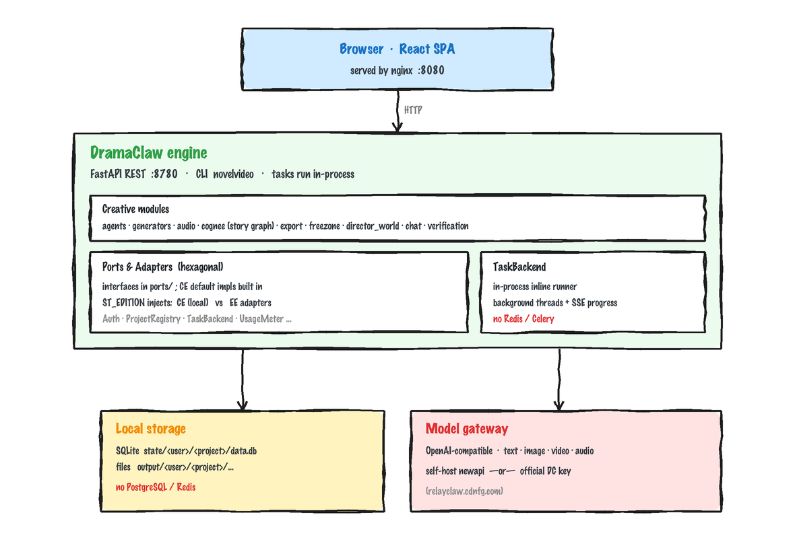

<!-- lang-switch -->
**English** · [简体中文](../../zh/concepts/architecture.md)

# Architecture

DramaClaw Community Edition (CE) is a **single-machine** "novel → finished video" pipeline: one FastAPI service hosts every creative capability, tasks run in-process, data lands locally, and models are reached through an OpenAI-compatible gateway. **No PostgreSQL / Redis required.**

## System Architecture

  

## Processing Flow

  

Every stage has its own interface, so you can run them in sequence, skip steps, or resume from any checkpoint.

## Code Structure

Main subpackages of `src/novelvideo/`:

| Package | Responsibility |
|---|---|
| `api` | Project-scoped REST routes |
| `agents` | Script / asset / identity / planning and other agents |
| `generators` | Image / video / audio generation adapters |
| `audio` | Voiceover (TTS) synthesis |
| `cognee` | Story knowledge graph (parses the novel, builds characters / relationships / timeline) |
| `freezone` | Free-form creative canvas |
| `director_world` | 3DGS / world scene features |
| `chat` | Conversational creative assistant |
| `export` | Episode composition and finished-video export |
| `verification` | Validation and review tooling |
| `task_backend` | Task scheduling and runner (in-process execution in CE) |
| `storage` / `sqlite_store` | Local storage |
| `ports` | Ports and adapters layer (see below) |
| `prompts` / `styles` | Baseline prompts and styles |

## Ports and Adapters (one codebase, two distributions)

DramaClaw uses **Ports & Adapters (hexagonal architecture)** to decouple the "engine" from its "runtime environment." `src/novelvideo/ports/` defines a set of Protocol interfaces, each with a **CE default implementation** (single-machine / local); the commercial Enterprise Edition (EE) provides enterprise adapters (multi-tenant / distributed) for the **same set of interfaces**.

The hard rule: **core code never imports enterprise code**; at runtime the matching implementation is injected based on `ST_EDITION`. The CE default implementations ship with the core and work out of the box.

| Port | CE default | Enterprise adapter |
|---|---|---|
| Auth | Local single user, no login | Multi-tenant auth |
| ProjectRegistry | Local SQLite index | Fleet registry / routing |
| ProjectAccess | owner-everywhere | Tenant RBAC |
| TaskBackend | In-process inline | Celery distributed |
| CancellationStore | In-process | Redis |
| UsageMeter | no-op | Metering and billing |
| Lifecycle | no-op | PG pool / Redis |
| AuditSink | Local NDJSON | Audit tables |
| CreditQuote | cost = 0 | Price table |

> The port definitions, the registry, and the CE default implementations all live on the core side; EE only supplies implementations plus registration at startup. This is what makes "one codebase, no fork between community and commercial" possible.

## Task Execution

CE's TaskBackend = **in-process inline** (background thread + EventSource progress stream): resumable, cancelable, but **no Redis / Celery needed**. The progress / cancellation experience in the task center matches the Enterprise Edition.

## Data and Storage

CE is fixed to a **single local user**, and all project data stays local:

- `state/<user>/<project>/data.db` (SQLite) — structured project data
- `output/<user>/<project>/...` — finished videos and assets

No external database is required.

## Model Access

All text / image / video / audio models are reached through a single **OpenAI-compatible gateway** (LocalAPI or an official key); see [Configuring Model Providers](../getting-started/configuring-models.md) for details.

## Motion Feature Film (MG) Pipeline

Three self-written modules under `freezone/` form a fully local render line — no external editing service, no stock footage:

| Module | Responsibility |
|---|---|
| `motion_templates` / `motion_media` | The 37-case gallery catalog (bundled `motion_templates.json` + posters) and **on-demand original caching** (`MOTION_GALLERY_ASSET_BASE` / `MOTION_GALLERY_MIRROR`) |
| `motion_render` (`page` / `chrome` / `capturer` / `encoder` / `pipeline`) | Validates the animated page the model writes against this system's render contract (`window.render(t)` / `window.DUR` / `window.EV`), injects a deterministic clock, captures it frame by frame through CDP with the bundled Chrome, and pipes the PNG stream straight into ffmpeg (`image2pipe`, no frames on disk); the encoder is chosen from a live `-encoders` probe, never hardcoded |
| `motion_audio` | Infers the beat grid from `window.EV` (median inter-onset interval, octave-folded into 45–180 BPM, phase aligned onto the action), synthesizes the score in numpy, normalizes it with two-pass `loudnorm` to **-14 LUFS / true peak ≤ -1 dBTP**, then muxes with `-c:v copy` |
| `motion_draft` | A from-scratch Jianying / CapCut 10.2 draft writer: root `draft_content.json` **plus** `Timelines/<uuid>/` and the mirrors, integer microseconds, video / narration / BGM on separate tracks (segments on one track may not overlap), `.locked` cleared |

The `*.motion.json` sidecar written next to each render records the beat grid and the audio engine verdict, and is the single source of truth for draft export. The desktop app relies on `resources/bin/` (ffmpeg, optionally Chrome); see [desktop/README.md](../../../desktop/README.md).

Every delivery chain shares one encoder resolver: `src/novelvideo/video_encoder.py` probes `ffmpeg -encoders` locally and takes the first usable H.264 implementation from `libx264 → h264_videotoolbox → h264_mf → libopenh264` (x264 gets CRF, the rest get a bitrate). MG's `motion_render/encoder.py`, the episode composer and the `jobs.py` one-tap tools all take their `-c:v` from there, so the bundled LGPL build (no x264) cannot break any of them; trade-offs and exceptions in the [ffmpeg guide](../guides/ffmpeg.md).

## Tech Stack

Python + FastAPI (REST API, `:8780`) · CLI `novelvideo` · React frontend · Docker Compose self-hosting.
